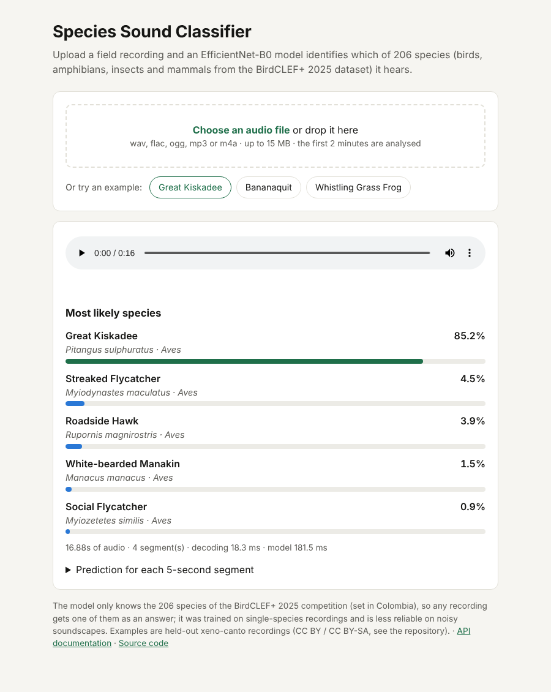

# Species Sound Classifier: a deployed audio model


Upload a field recording, get the species. This repository turns the best model from my [BirdCLEF+ 2025 project](https://github.com/youssef-khazal/birdclef-2025) (EfficientNet-B0, 206 species, 0.96 ROC-AUC on recordings never seen in training) into a **web service**: exported to **ONNX**, served with **FastAPI**, packaged with **Docker**, tested in **CI**, and deployed as a public demo.

**Live demo:** [huggingface.co/spaces/youssef-khazal/species-sound-classifier](https://huggingface.co/spaces/youssef-khazal/species-sound-classifier)



---

## What it does

`POST /predict` with an audio file (wav, flac, ogg, mp3, or m4a via ffmpeg) returns the most likely species:

```bash
curl -F "file=@examples/great_kiskadee_XC248744.ogg" https://<host>/predict
```
```json
{
  "duration_seconds": 16.88,
  "segments": 4,
  "top_k": [
    {"code": "grekis", "common_name": "Great Kiskadee", "scientific_name": "Pitangus sulphuratus", "group": "Aves", "probability": 0.852},
    {"code": "strfly1", "common_name": "Streaked Flycatcher", "scientific_name": "Myiodynastes maculatus", "group": "Aves", "probability": 0.045}
  ],
  "per_segment": [
    {"start_seconds": 0, "common_name": "Great Kiskadee", "probability": 0.967},
    {"start_seconds": 5, "common_name": "Great Kiskadee", "probability": 0.765}
  ],
  "timing_ms": {"decode": 14.4, "inference": 149.1}
}
```
<sub>(shortened)</sub>

Like the original evaluation, the recording is cut into 5-second segments, each segment is classified, and the probabilities are averaged. Other endpoints: `GET /health`, `GET /species` (the 206 species), `GET /docs` (interactive API documentation), `GET /` (demo page).

---

## From a training checkpoint to a service

| Step | How | Check |
|---|---|---|
| Preprocessing | Re-implemented without PyTorch: 32 kHz mono, 5 s segments, 64-band log-Mel, the same 8-bit grayscale image as training, 224x224, scaled to [-1, 1] | **Pixel-identical** to a spectrogram from the training set (`tests/test_preprocessing.py`); zero difference from the torchvision training transform on 3,000 validation images |
| Model export | PyTorch → ONNX (opset 17, dynamic batch) | Same top-1 prediction as PyTorch on 100% of 3,000 validation segments; logits within 1e-4 |
| Serving | FastAPI + ONNX Runtime (CPU), input validation (size, length, format), model warm-up at start-up | 19 preprocessing, model and API tests run on every push |
| Packaging | Docker (python:3.12-slim + ffmpeg, non-root user), health check | CI builds the image and sends a real recording to the running container |
| Deployment | The same image runs on Hugging Face Spaces | Public demo |

---

## Benchmark (CPU)

Measured with `scripts/benchmark.py` on 3,000 segments from the held-out validation split of the original project (178 species), on a 2-core x86-64 CPU, batch of 1:

| Model | Size | Top-1 | Top-5 | Latency, 1 thread | Latency, 2 threads | 30 s recording, end to end |
|---|---|---|---|---|---|---|
| PyTorch FP32 (reference) | 17.4 MB | 61.8% | 76.7% | 24.3 ms | 22.1 ms | — |
| **ONNX FP32 (served)** | 17.1 MB | **61.8%** | **76.7%** | **10.5 ms** | **6.3 ms** | **105 ms** |
| ONNX INT8 (static, per-channel) | 5.2 MB | 41.4% | 59.5% | 9.0 ms | 6.4 ms | 102 ms |

<sub>Top-1 on this sample (61.8%) matches the full validation set of the original project (61.8%). "End to end" includes the spectrogram computation for all six segments, so a 30 s recording is processed about 280 times faster than real time.</sub>

**Takeaways**
- **ONNX Runtime is 2.3x faster than PyTorch on one CPU thread** (3.5x with two) with identical predictions, so the service needs no GPU and no PyTorch install, which keeps the image much smaller.
- **INT8 quantization was not worth it for this model.** It makes the file 3.3x smaller but costs 20 points of top-1 accuracy and brings no speed-up on this CPU. Leaving the squeeze-and-excitation blocks, the first convolution and the classifier in FP32 only recovered part of the loss (48% top-1 on a 1,000-segment subset). EfficientNet's depthwise convolutions and SE blocks are known to be sensitive to post-training quantization; quantization-aware training would be the next step. The FP32 model is the one deployed.

---

## Run it

**With Docker** (recommended):
```bash
docker build -t species-classifier .
docker run -p 7860:7860 species-classifier
# open http://localhost:7860
```

**With Python** (3.10+):
```bash
pip install -r requirements.txt && pip install -e ".[dev]"
uvicorn birdclef_api.app:app --port 7860
pytest
```

**Re-export the model** from a BirdCLEF training run (needs PyTorch):
```bash
pip install -e ".[export]"
python scripts/export_onnx.py --run-dir <birdclef-2025>/runs/efficientnet_b0_recording_seed42 \
    --taxonomy data/taxonomy.csv --calibration-dir data/calibration_pngs --out-dir models
python scripts/benchmark.py --val-dir data/val_sample --run-dir <run> --audio examples/great_kiskadee_XC248744.ogg
```
The calibration images for INT8 come from the training split; the benchmark images from the validation split.

---

## Repository structure

```
src/birdclef_api/
  preprocessing.py   audio -> spectrogram -> model input (no PyTorch needed)
  model.py           ONNX Runtime classifier: segment probabilities, top-k species
  app.py             FastAPI app: /predict, /health, /species, demo page
  static/index.html  demo page (upload or try an example)
models/              efficientnet_b0.onnx (served), efficientnet_b0_int8.onnx, labels.json
scripts/             export_onnx.py (PyTorch -> ONNX -> INT8), benchmark.py
examples/            three held-out recordings (see attribution below)
tests/               preprocessing parity, model, API
results/             benchmark.json, figures
Dockerfile           the image deployed on Hugging Face Spaces
```

---

## Limitations

- **206 species only.** The model knows the species of the BirdCLEF+ 2025 competition (set in Colombia); a recording of any other species still gets one of these 206 answers. Rejecting "unknown" sounds would need a calibrated threshold.
- **Focal recordings vs soundscapes.** It was trained on recordings with one main species; on long, noisy multi-species soundscapes it is much less reliable (see the original project).
- **Free CPU hosting.** The demo runs on a small shared CPU; the first request after a pause can take a few seconds while the Space wakes up.

---

## Attribution

Example recordings come from the BirdCLEF+ 2025 data (xeno-canto). All three are from the **validation** split, so the model never saw them during training:

| File | Species | Recordist | Licence | Source |
|---|---|---|---|---|
| `great_kiskadee_XC248744.ogg` | Great Kiskadee | Niels Krabbe | CC BY-SA 4.0 | [XC248744](https://xeno-canto.org/248744) |
| `bananaquit_XC912389.ogg` | Bananaquit | Juan Antonio Alonso de Juan | CC BY 4.0 | [XC912389](https://xeno-canto.org/912389) |
| `whistling_grass_frog_XC882794.ogg` | Whistling Grass Frog | M.S. Hoogmoed | CC BY 4.0 | [XC882794](https://xeno-canto.org/882794) |

`tests/data/great_kiskadee_XC248744_seg0_training.png` is a spectrogram of the first recording (CC BY-SA 4.0).

**Author:** Youssef Khazal ([GitHub](https://github.com/youssef-khazal) · [LinkedIn](https://www.linkedin.com/in/youssef-khazal) · [Portfolio](https://youssef-khazal.netlify.app/)). Code under the [MIT License](LICENSE).
